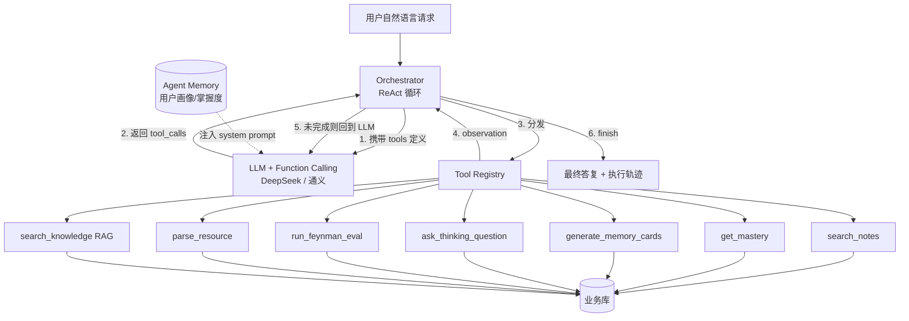
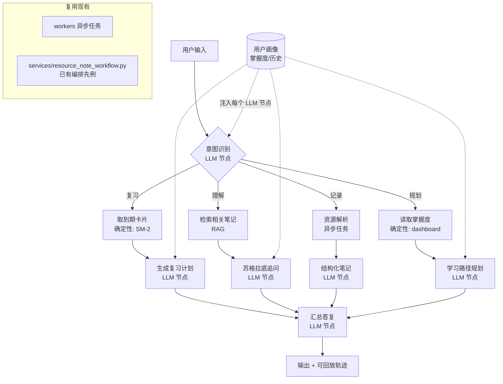
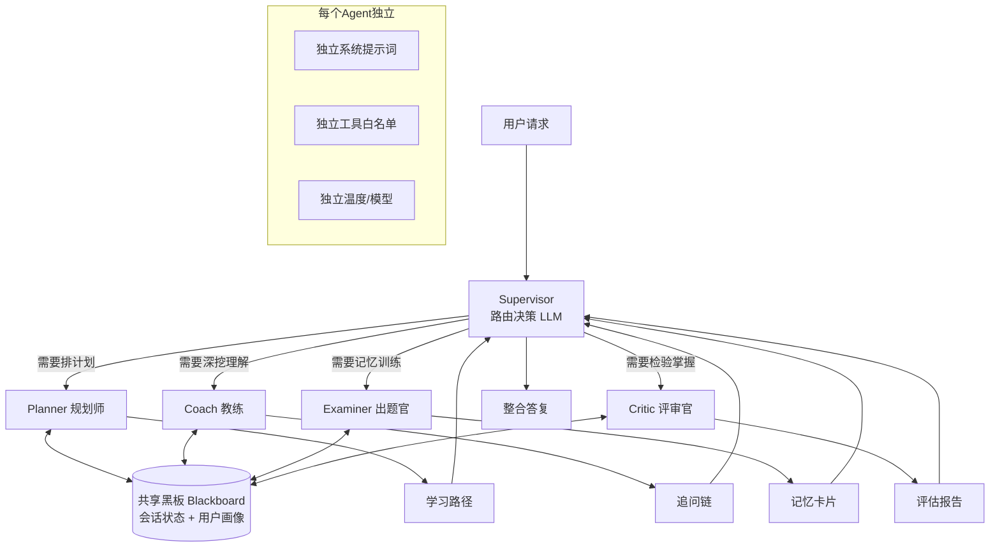

# 木铎笔记 · Agent 化改造三方案对比

> 生成时间：2026-10-27
> 适用赛事：第二届全国人工智能应用创新大赛（通用赛道 · AI Agent 赋能行业创新）
> 团队假设：前端 1 人 + 后端 2 人，Claude Code 辅助开发，可用工期约 2–4 周
> 前置阅读：《项目现状与完善建议.md》《参赛准备与Agent化包装方案.md》

---

## 〇、先明确一件事：什么叫"包装成 Agent"

评委会看三样东西，缺一个就不像 Agent：

| 要素 | 含义 | 木铎现状 |
|------|------|---------|
| **Tool Use** | 大模型能主动调用后端能力，而不只是生成文字 | 🔴 只有单轮 `generate` |
| **Orchestration** | 多步决策：先做什么、看结果、再决定下一步 | 🔴 一次请求一次响应 |
| **Memory / Context** | 记住用户画像、掌握度、历史，影响后续决策 | 🟡 有 SM-2 数据但没喂给模型 |

三个方案的区别，本质是**"把这三要素做到多深、用哪种方式实现"**。

```
自主性 低 ────────────────────────────────► 高
        方案B              方案A
   工作流图Agent       ReAct编排Agent
    (可控、可复现)      (自主、不可控)

        方案C 多Agent协作（正交维度：角色分工）
```

---

## 方案 A：ReAct 编排式 Agent（自主工具调用）

### A.1 核心思路

用户说一句自然语言，大模型**自己决定调哪个工具、传什么参数、调几次**，直到任务完成。这是教科书意义上最"正宗"的 AI Agent。

```
用户: "帮我把这周的计网笔记整理一下，挑我薄弱的地方出题考我"
  ↓
LLM 思考: 需要先找到本周计网笔记 → 调 search_notes
  ↓ 观察结果
LLM 思考: 有 4 篇，需要看掌握度 → 调 get_mastery
  ↓ 观察结果
LLM 思考: "三次握手"掌握度 0.3 → 调 generate_memory_cards(note_id=..., focus="薄弱点")
  ↓ 观察结果
LLM: 汇总并输出"今天先练这 5 张卡"
```

### A.2 架构



### A.3 具体改造点

| 位置 | 改造 |
|------|------|
| `backend/app/integrations/llm.py` | `LLMProvider` 协议新增 `generate_with_tools(messages, tools, tool_choice)`；`DeepSeekProvider` 用 OpenAI 兼容的 `tools` 参数实现 |
| `backend/app/agent/tool_registry.py` | **新增**。8 个工具的 JSON Schema + 执行函数映射 |
| `backend/app/agent/orchestrator.py` | **新增**。ReAct 循环：`max_steps=8`、超时、异常兜底 |
| `backend/app/agent/session.py` | **新增**。会话持久化（复用 `ai_tasks` 的异步任务模型） |
| `backend/app/agent/memory.py` | **新增**。把 `memory` 的 SM-2 数据、`dashboard` 掌握度组装成 system context |
| `backend/app/api/v1/` | 新增 `POST /agent/chat`（同步或 SSE 流式） |
| `frontend/src/features/agent/` | **新增** Chat 面板；展示"工具调用轨迹"（这是加分项，让评委看见 Agent 在工作） |

### A.4 工作量与风险

| 项 | 估计 |
|----|------|
| 后端 | 10–14 人日 |
| 前端 | 5–7 人日 |
| 技术风险 | **高**：循环不收敛、工具误调用、延迟 3–10 秒、现场 API 抖动直接翻车 |
| 演示可控性 | **低**：同一个问题两次跑，路径可能不一样 |

### A.5 评分收益

- 「可验证智能体交互能力」：⭐⭐⭐⭐⭐
- 「模型与流程」章节：好写，有真实工具调用日志可截图
- 「应用演示截图」：工具轨迹截图非常出彩

---

## 方案 B：工作流图 Agent（状态机 + LLM 决策节点）

### B.1 核心思路

**开发者画出学习任务的流程图，每个节点可以是确定性的（查库、算 SM-2）或 LLM 决策的（判断意图、选择分支、生成内容）。** 这是 LangGraph 的思路，业界叫 **Agentic Workflow**。

和 A 的关键区别：**"下一步走哪"由代码图决定，节点内部才交给 LLM**。所以结果可复现、可单测、可演示。

```
[意图识别 LLM] → [取上下文 RAG] → [规划 LLM]
                                      ↓
                         ┌────────────┼────────────┐
                     分支:复习      分支:理解      分支:记录
                         ↓            ↓            ↓
                  [SM-2 确定性]  [苏格拉底 LLM]  [结构化 LLM]
                         └────────────┼────────────┘
                                 [汇总 LLM] → [输出]
```

### B.2 架构



### B.3 具体改造点

| 位置 | 改造 |
|------|------|
| `backend/app/agent/graph.py` | **新增**。节点定义 + 边定义 + 条件路由 |
| `backend/app/agent/nodes/` | **新增**。每类节点一个文件，`intent.py` / `plan.py` / `review.py` / `socratic.py` / `summarize.py` |
| `backend/app/agent/state.py` | **新增**。图状态对象（TypedDict），节点间传递 |
| `backend/app/services/agent_service.py` | **新增**。编排入口，仿照 `resource_note_workflow.py` 的写法 |
| `backend/app/integrations/llm.py` | 只需新增结构化输出（JSON mode）支持，**不需要 Function Calling** |
| `backend/app/workers/handlers.py` | 长任务（资源解析）挂到现有异步队列 |
| `frontend/src/features/agent/` | **新增** Chat 面板 + 流程可视化（把走过的节点点亮，视觉冲击强） |

### B.4 工作量与风险

| 项 | 估计 |
|----|------|
| 后端 | 6–9 人日 |
| 前端 | 3–5 人日 |
| 技术风险 | **低**：每个节点可单测，路径确定，失败可降级 |
| 演示可控性 | **高**：同一输入走同一条路径，彩排即所见 |

### B.5 评分收益

- 「可验证智能体交互能力」：⭐⭐⭐⭐（自主性弱于 A，但可验证性强）
- 「模型与流程」章节：**最好写**，流程图天然可截图
- 「（五）思考与建议」：节点级优化建议有抓手
- 答辩时最好防守："为什么用工作流图而不是全自主？" → "教育场景要求**可预期、可解释、可追责**，不能让学生收到随机建议"（这是个很硬的论点）

---

## 方案 C：多 Agent 角色协作（"AI 学习小组"）

### C.1 核心思路

不做一个大 Agent，而是做一个**角色分工的 Agent 团队**，由一个 Supervisor 调度。每个角色有独立人格、独立提示词、独立工具权限。

```
Supervisor（学习委员）
   ├─ Planner 规划师   —— 拆学习目标、排计划
   ├─ Coach 教练       —— 苏格拉底式追问（对应思考模式）
   ├─ Examiner 出题官  —— 生成记忆卡、出题（对应记忆模式）
   └─ Critic 评审官    —— 费曼评估、打分、找漏洞（对应费曼模式）
```

用户看到的是"我有一支 AI 学习团队"，而不是"一个聊天框"。

### C.2 架构



### C.3 具体改造点

| 位置 | 改造 |
|------|------|
| `backend/app/agent/personas/` | **新增**。4 个角色的 system prompt（Planner/Coach/Examiner/Critic） |
| `backend/app/agent/supervisor.py` | **新增**。路由逻辑（LLM 判断 or 规则） |
| `backend/app/agent/blackboard.py` | **新增**。共享状态，避免角色间重复读库 |
| `backend/app/modules/thinking/` | Coach 复用现有追问逻辑，改造为可被 Agent 调用 |
| `backend/app/modules/memory/` | Examiner 复用卡片生成 + SM-2 |
| `backend/app/modules/feynman/` | Critic 复用 5 轮评估逻辑 |
| `backend/app/modules/dashboard/` | Planner 复用掌握度 |
| `frontend/src/features/agent/` | **新增**。最重要的差异化："多角色对话界面"——每个角色有头像、名字、发言气泡 |

### C.4 工作量与风险

| 项 | 估计 |
|----|------|
| 后端 | 12–18 人日 |
| 前端 | 6–8 人日 |
| 技术风险 | **最高**：角色串话、调度死锁、token 成本 ×3、延迟 ×2 |
| 演示可控性 | **中低**：多角色交互好看但难彩排 |

### C.5 评分收益

- 「创新性」：⭐⭐⭐⭐⭐（"AI 学习小组"叙事很强）
- 「跨学科视角」：⭐⭐⭐⭐⭐（教育学里的"协作学习 / 同伴辅导"理论直接支撑）
- 「可验证智能体交互」：⭐⭐⭐⭐

---

## 三方案横向对比

| 维度 | 方案 A · ReAct 编排 | 方案 B · 工作流图 | 方案 C · 多 Agent |
|------|-------------------|------------------|------------------|
| 自主性 | 高 | 中 | 高（角色维） |
| 工程风险 | 高 | **低** | 最高 |
| 演示稳定性 | 低 | **高** | 中低 |
| 后端工作量 | 10–14 人日 | **6–9 人日** | 12–18 人日 |
| 前端工作量 | 5–7 | **3–5** | 6–8 |
| 创新性叙事 | 中 | 中 | **最高** |
| 可验证性/可解释 | 中 | **高** | 中 |
| 与现有代码契合 | 中（要重写调用链） | **高（复用 workflow 先例）** | 中高（复用三模式） |
| 答辩防守难度 | 中（"为什么不稳定"） | **低** | 高（"为什么需要 4 个"） |

---

## 我的建议

### 推荐：**方案 B 打底 + 吸收 A 的工具抽象 + 借 C 的叙事**

理由三条：

1. **时间**：校赛窗口已经很紧，B 是唯一能保证"跑得通、录得成视频"的方案。A 和 C 都有现场翻车风险，而比赛只给一次演示机会。

2. **评分逻辑**：附件1 反复强调"**可验证**智能体交互"和"**实验证明合理性**"。B 的确定性流程正好对应"可验证"，而且「（三）模型与流程」这一章要画思维导图 + 实验验证——状态机图天然就是那张图。

3. **成本最低的加分项**：把 A 的 `tool_registry.py` 抽出来给 B 用，PPT 里就能写"我们采用了工具化架构"；把 C 的"多角色"作为**前端呈现**（Coach/Examiner/Critic 三个面具）而不是真做 4 个 Agent——叙事收益一样，工程成本砍一半。

### 落地顺序（如果选推荐路线）

```
第1周  清理 P0 的 Mock → 抽 tool_registry → 建 graph.py 骨架（3条主路径）
第2周  接 Function Calling（给2-3个工具）→ 前端 Chat 面板 + 节点点亮
第3周  补 Embedding + RAG → 彩排 → 录视频 → 做 PPT
第4周  缓冲 + 脱敏检查 + 提交
```

### 什么时候该选 A

如果你满足：**工期 ≥ 4 周**，且团队有人写过 Agent 编排、有信心做流式 + 重试 + 降级。收益是「（三）模型与流程」和「（六）演示截图」两章会非常漂亮——工具调用轨迹是评委最认的"这是真 Agent"的证据。

### 什么时候该选 C

如果**创新性是你的主要短板**（比如同赛道队伍都是"知识库问答"），C 的"AI 学习小组"叙事能直接拉开差距。但必须接受：演示视频要拍 3 遍以上，且要给 Supervisor 加死规则兜底。

---

## 附：三方案与附件1 PPT 章节的对应

| PPT 章节 | A | B | C |
|---------|---|---|---|
| （二）预处理流程图 · Agent 用途 | 工具编排图 | **状态机图** | 角色协作图 |
| （三）模型与流程 · 思维导图 | ReAct 循环图 | **节点流程图** | Supervisor 调度图 |
| （三）实验验证 | 工具调用日志 | **节点单测 + 端到端用例** | 角色协同案例 |
| （四）创新点 | 自主工具调用 | Agentic Workflow | **多角色协作学习** |
| （四）跨学科 | 弱 | 中（认知科学） | **强（协作学习理论）** |
| （六）演示截图 | **工具轨迹** | 流程点亮 | **多角色对话** |
