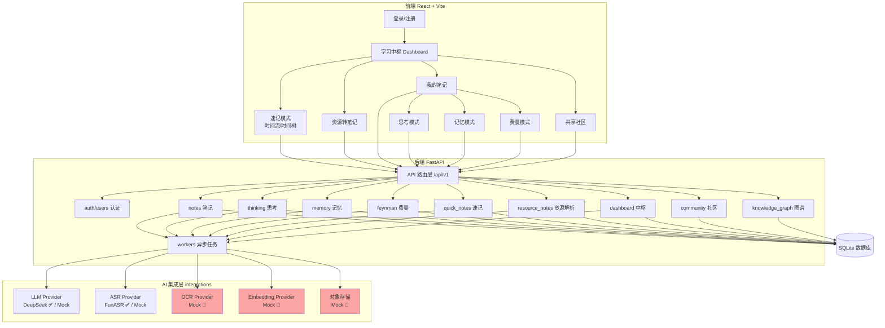
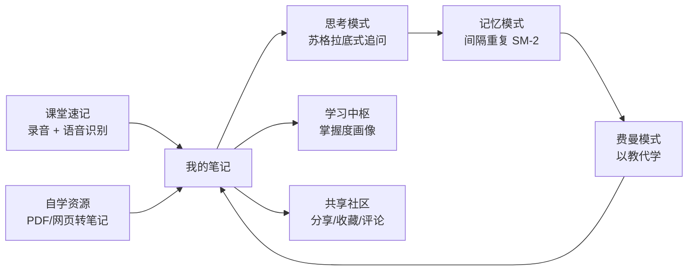
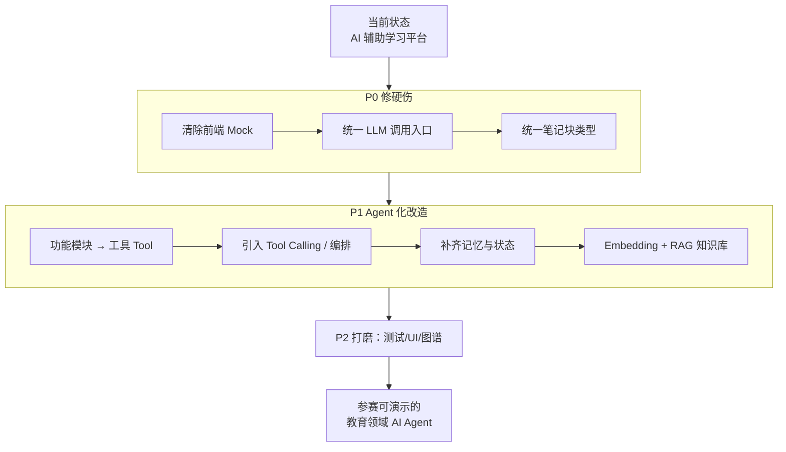

# 木铎笔记（Muduo Notes）项目现状与完善建议

> 生成时间：2026-10-27
> 当前分支：`leader-g1-mty`（最近提交：2026-07-26）
> 数据来源：`README.md`、`docs/RECENT.md`、`docs/code-review-2026-06-30.md`、源码实际核对

---

## 一、项目是什么

木铎笔记是一个 **AI 辅助学习平台**，目标是搭建一条完整的学习闭环：从「记录」到「理解」到「记忆」到「输出」。产品定位一句话：**帮助学生更好学习、记忆与输出的智能学习工具**。

核心围绕两条学习链路展开：

```
链路 A（课堂）：速记（时间流/时间树）→ 我的笔记 → 思考 → 记忆 → 费曼 → 闭环
链路 B（自学）：资源转笔记          → 我的笔记 → 思考 → 记忆 → 费曼 → 闭环

支撑层：学习中枢（Dashboard）+ 共享社区（Community）
```

---

## 二、技术栈与系统架构

| 层 | 技术 |
|----|------|
| 前端 | React 18 + Vite 5 + Tailwind CSS 3 + React Router 6 |
| 后端 | Python 3.11+ / FastAPI / SQLAlchemy 2 / Alembic |
| 数据库 | SQLite（开发）/ 生产可用 PostgreSQL |
| AI 集成 | `integrations/` 抽象层（LLM / OCR / ASR / Embedding / 对象存储） |

### 后端模块（15 个）

`ai_tasks`、`auth`、`community`、`courses`、`dashboard`、`feynman`、`import_export`、`knowledge_graph`、`memory`、`notes`、`quick_notes`、`resource_notes`、`resources`、`thinking`、`users`

---

## 三、功能模块现状总览

| 模块 | 后端 | 前端 | 整体完成度 | 说明 |
|------|------|------|-----------|------|
| 用户认证（auth/users） | ✅ 完整 | ✅ 完整 | 🟢 高 | JWT 登录、注册、开发引导账号 |
| 我的笔记（notes） | ✅ 完整 | ✅ 基本完成 | 🟢 高 | TipTap 编辑器 + note_type 分类 + 右键菜单/导出 MD/分享 |
| 速记·时间流（quick_notes） | ✅ 基本完成 | ✅ 基本完成 | 🟢 高 | 已接 FunASR 语音识别 + AI 整合 |
| 速记·时间树（time-tree） | ✅ 已实现 | ✅ 已实现 | 🟢 高 | 拖拽/录音/AI/撤销/视频上传（较晚提交） |
| 资源转笔记（resource_notes） | ✅ 完整 | ✅ 基本完成 | 🟢 中高 | PDF/网页解析 + 通义千问（qwen_client）+ 多模态整合 |
| 思考模式（thinking） | ✅ 完整 | ⚠️ 部分 Mock | 🟡 中 | 后端完整；前端 `COACH_PROMPTS` 仍写死，未动态追问 |
| 记忆模式（memory） | ✅ 完整 | ✅ 基本完成 | 🟢 高 | SM-2 间隔重复算法 + AI 卡片生成 |
| 费曼模式（feynman） | ✅ 完整 | ✅ 基本完成 | 🟢 高 | DeepSeek 对话 + 5 轮评估 + 保存总结 |
| 学习中枢（dashboard） | ⚠️ 骨架 | ⚠️ Mock 兜底 | 🟡 中 | `ACTIVITIES`/`AI_SUGGESTIONS`/`RECENT_COURSES` 仍为写死数据 |
| 共享社区（community） | ✅ 完整 | ⚠️ 部分 Mock | 🟡 中 | 帖子列表已接后端；`FOLLOW_DATA` 仍写死 |
| 知识图谱（knowledge_graph） | ✅ 基础 | ⚠️ 未可视化 | 🟡 中低 | 模块存在，可视化延后至 v1.1 |
| 导入导出（import_export） | ✅ 基础 | ⚠️ 未接入 | 🟡 低 | 延后至 v1.1 |
| AI 任务（ai_tasks） | ✅ 基础 | — | 🟡 中 | 异步任务管理 |

---

## 四、AI 能力现状（关键结论）

**木铎目前是「AI 辅助学习平台」，还不是真正的「AI Agent」。**

现有 AI 集成通过 `backend/app/integrations/` 抽象层接入：

| 能力 | 真实 Provider | Mock | 状态 |
|------|--------------|------|------|
| LLM（大模型） | DeepSeek（OpenAI 兼容，单次 `generate`） | ✅ MockLLM | 🟡 已接但**只有单轮生成** |
| ASR（语音识别） | FunASR | ✅ Mock | 🟢 已接真实服务 |
| OCR（文字识别） | ❌ 无 | ✅ Mock | 🔴 仅 Mock |
| Embedding（向量化） | ❌ 无 | ✅ Mock | 🔴 仅 Mock（RAG 未落地） |
| 对象存储 | ❌ 无 | ✅ Mock | 🔴 仅 Mock |

**差距要点：**

1. **没有 Tool Calling / Function Calling** —— LLM 只能「一问一答」，不能调用后端工具。
2. **没有 Agent 编排循环** —— 无 ReAct / 多步规划 / 任务分解。
3. **没有长期记忆与状态管理** —— 用户学习画像、掌握度未作为 Agent 上下文。
4. **知识库检索（RAG）未落地** —— Embedding 仍是 Mock，无法对笔记做语义检索。
5. **存在「绕开统一入口」的散装调用** —— `notes` 模块 AI 生成曾直连 `urllib` 调 DeepSeek，不走 `integrations` 抽象（见 code-review 2.2）。

> 这五点正是把木铎「包装成 AI Agent」参加比赛时需要补齐的核心差距（详见《参赛准备与 Agent 化包装方案》）。

---

## 五、需要完善的地方（按优先级）

### 🔴 P0 —— 影响上线/演示的硬伤

1. **前端 Mock 数据残留**
   - `Dashboard.jsx`：`ACTIVITIES` / `AI_SUGGESTIONS` / `RECENT_COURSES` 三处写死
   - `ThinkingMode.jsx`：`COACH_PROMPTS` 写死，追问与笔记内容无关
   - `Community.jsx`：`FOLLOW_DATA` 写死
   - 影响：演示时数据不真实，评委一眼看穿「假数据」。

2. **AI 生成未统一走 Provider 抽象**
   - `notes` 模块 AI 生成历史上有直连 `urllib` 的代码，API Key 硬编码。
   - 影响：换模型/维护成本高，错误处理会把技术报错透传给用户。

3. **笔记块类型定义三处不一致**
   - `contracts/enums.md` 5 种 / 后端 `schemas/enums.py` 12 种 / 前端 `constants.js` 5~9 种自相矛盾。
   - 影响：后端返回 `ai_summary`、`thinking` 等块时前端无法正确渲染。

### 🟡 P1 —— 决定「是否像 Agent」的关键

4. **补齐 Agent 三要素：工具调用 + 编排 + 记忆**
   - 将四大学习模式改造为 Agent 可调用的 Tool（详见参赛方案）。
5. **OCR / Embedding / 对象存储仍为 Mock**
   - 至少 Embedding 需接真实服务（如 DashScope 文本向量），才能支撑语义检索知识库。
6. **格式规范统一落地（RECENT 阶段 3）**
   - 思考/记忆/费曼/速记写回笔记的 block 格式需统一，否则全链路渲染错乱。

### 🟢 P2 —— 打磨项

7. **记忆库演示数据启动时重置**（`main.py` 有 reset 逻辑，生产环境须关闭）。
8. **端到端流程测试缺 5 条**（RECENT 7-1：笔记/思考/记忆/费曼/资源各 1 条）。
9. **知识图谱可视化、导入导出** 延后到 v1.1，比赛可酌情补充。
10. **UI 统一**（标题字号/语义色/通用 Empty/Error/Loading 组件）。

---

## 六、系统流程图

### 6.1 系统现状架构流程图



### 6.2 产品学习闭环流程图



### 6.3 完善优先级路线图



---

## 七、后续建议

1. **短期（参赛前）**：优先完成 P0 三项，保证演示「数据真实、接口统一、渲染正确」。
2. **中期（Agent 化）**：完成 P1 四项，把木铎从「单轮 LLM 调用」升级为「可调用工具、有记忆、能规划的 AI Agent」——这正是大赛「AI 智能体」命题的核心要求。
3. **长期**：补测试、UI 统一、知识图谱可视化，形成可上线产品。

> 具体参赛材料清单与 Agent 化改造步骤，见同目录《参赛准备与 Agent 化包装方案.md》。
